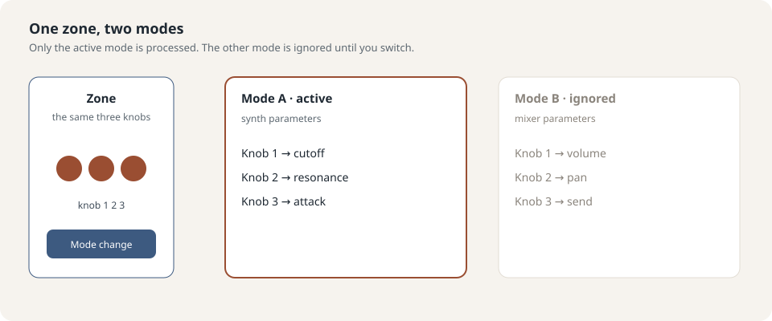
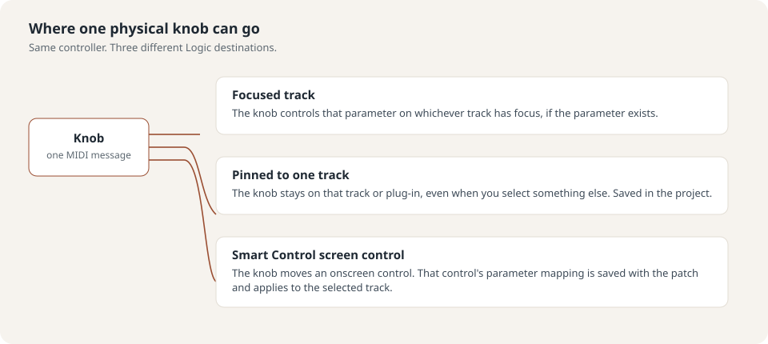

A knob on a MIDI controller does nothing in Logic until Logic is told which parameter should move when that knob sends its message. You can point the same physical control at a mixer fader, a plug-in knob, or a Smart Control, and you can keep more than one of those mappings and switch between them.

Logic's name for that link is a controller assignment. The window that holds them is Controller Assignments. It has an Easy view for channel-strip and plug-in parameters, and an Expert view for everything else, including groups of controls called zones and modes. Smart Controls are a separate layer: onscreen controls for the selected track, which a hardware knob can drive.

!!! note
    Checked on 27 November 2026 against Apple's Logic Pro User Guide for Mac and the Logic Pro for Mac release notes. Those notes, published 6 November 2026, list Logic Pro for Mac 13.0 as the current version. They say B now opens the Browser and Y toggles Smart Controls. The Smart Controls overview page still says B. Where those disagree, use View > Show Smart Controls or the Smart Controls button in the control bar. Nothing below has been run in this studio.

## Use a controller you already own

Logic works with USB and MIDI keyboards and with other MIDI devices, including control surfaces, pedals, and switches. It recognizes the MIDI devices set up in Audio MIDI Setup, the macOS utility in Applications/Utilities.

A USB controller plugs into the Mac. A controller that only has 5-pin MIDI ports needs a MIDI interface between it and the computer. Some interfaces appear on their own. Others need the manufacturer's driver. For a control surface that Logic should also send information back to, connect both the MIDI input and the MIDI output. Apple recommends plugging a control surface into the computer directly, not through a hub, and not daisy-chaining other MIDI devices through the ports that surface uses.

You do not have to install an unsupported controller as a control surface before you can learn its knobs. Any controller that sends a MIDI message can be assigned in Controller Assignments. A supported control surface is different: Logic already has assignments for it, and those become active when you add the device. You can change them.

Some USB controllers are handled by a Lua script. The first time you connect one, Logic asks whether to use it as a control surface.

- Auto Assign builds assignments from the script. Knobs go to Smart Control knobs, buttons go to onscreen buttons and key commands, and a single fader labeled Volume goes to the selected channel strip's volume. Those assignments live in a zone named after the device. That zone is modeless, so it stays active, and it works with Control Surface Group 1.
- No leaves the device as a plain MIDI controller, with no automatic assignment.

Change that later in Logic Pro > Control Surfaces > Settings > MIDI Controllers. The Auto checkbox is the same choice. Turning it off removes the script's assignments and keeps assignments you have edited. If a control already has an assignment you made, turning Auto on does not replace it.

A few USB controllers, including some from Arturia, send transport as MIDI Machine Control. For those, turn on Listen to MMC under File > Project Settings > Synchronization > MIDI. That is only the transport. The knobs are still ordinary MIDI.

If a supported surface seems silent, check Logic Pro > Control Surfaces > Bypass all Control Surfaces. That command mutes every control surface. Apple documents it for silencing motorized faders and for chasing MIDI trouble. Assignments come back when you turn the bypass off.

## See whether the MIDI is what you expect

Four Apple tools answer different questions. None of them is a full MIDI logger, and Audio MIDI Setup does not show controller numbers.

**Is the port alive?** In Audio MIDI Setup, choose Window > Show MIDI Studio. A device that is off or unplugged is dimmed. Double-click it and confirm Device is online if you expected it to be connected. Click Test MIDI Setup. Play a note on the controller. The up arrow on that device, the In port, highlights when the Mac receives something. Click the down arrow to send a test message out. Click Test MIDI Setup again to stop. A highlight means a message arrived. It does not tell you the controller number or the value.

**What was the last message?** In Logic, click the down arrow on the right side of the LCD in the control bar and choose Custom. Custom adds MIDI In and MIDI Out status to the display. The MIDI Activity area then shows the last message received on the top line and the last message sent on the bottom line. Apple says to use it to check MIDI connections. Several notes at once are shown as a chord. The guide does not spell out the exact text used for a control-change message, so treat the line as "a message arrived," and use the tools below when you need the number.

Clicking the activity display also sends a reset, and double-clicking it sends a Note Off for every note. Use it to look, not as a button, while you are checking a controller.

**What did Learn actually hear?** While Learn mode is on, the Input message field in Controller Assignments shows the MIDI message from the control you moved. In Easy view, the Link button selects the assignment that matches the most recently received message. That field is the most direct readout of the message Logic will store.

**What landed in a region?** The Event List shows the events in a region, including controller events, with their channel and values. Record a few seconds of the knob, then click List Editors in the control bar and click Event (the default key command is D), or choose Window > Open Event List (Command-7). This is a list of recorded events, not a live tap of the input.

**A live list in the Environment.** The Environment is a legacy window, kept for older projects. Incoming MIDI has to pass from the Physical Input object to the Sequencer Input object before Logic can record it. You can insert a monitor object on that path. Hold Option and choose Window > Open MIDI Environment (or press Command-0 while Option is held), then choose New > Monitor. A monitor shows the MIDI and meta events that pass through it, up to the last 32, newest at the bottom. Click the monitor to clear it. Apple's signal-path page names a monitor between Physical Input and Sequencer Input as the way to see incoming events. Cable it there if the new monitor is not already in that path. The Environment overview says you do not need this window for ordinary recording.

Logic ignores note messages during Learn unless you turn that off, so a keyboard can still play while you assign knobs. A pad or button that sends notes will not be learned until you change that. In Easy view, open the Action menu and deselect Ignore MIDI Notes While Learning. The same menu is in Expert view.

## Map mixer and plug-in controls

### Easy view

Easy view assigns channel-strip and plug-in parameters. Volume, pan, solo, mute, and sends are channel-strip parameters. A plug-in or software-instrument knob is a plug-in parameter. Select the control in the Mixer or in the plug-in window first, so Logic knows the destination.

1. Select the parameter. For a series of faders, select the first volume fader. For one plug-in knob, click that knob.
2. Choose Logic Pro > Control Surfaces > Learn Assignment for [parameter name]. The Controller Assignments window opens in Easy view with Learn mode on. The Parameter field usually shows the name you selected. You can also use the Learn new Controller Assignment key command.
3. Move the hardware control. Its message appears in the Input message field.
4. Click Learn Mode, or press Command-L, to finish. If you leave Learn on, you can select another parameter and move another control, then turn Learn off when the batch is done.

The Channel Strip menu in Easy view chooses the track the assignment applies to: the selected track, or the channel strip number you type next to it. That is the simple form of the focused-track and pinned-track choice described below.

To map a row of faders to a row of volume controls, learn the first fader to the first parameter and the last fader to the last parameter, with the same number of steps between them. Logic asks whether to fill the assignments in between. Confirm. Apple limits that shortcut to knobs that send a single channel message, controller number then value, or a controller number carried in the MIDI channel. Check the controller's own documentation for which of those it sends.

To remove an assignment in Easy view, select it and click Delete.

A modifier key can be part of the assignment. Start Learn, hold Command or another modifier while you select the parameter and move the control, then end Learn. If a message arrives while the key is down, Learn turns off when you release the key.

### Expert view

Easy view is the wrong place for global commands, automation, control-surface group parameters, zones, and modes. Choose Logic Pro > Control Surfaces > Controller Assignments (Command-K), then click Expert View.

The window is three lists plus the parameter area:

- Zone list. No Zone holds assignments that stay active no matter which zone is selected.
- Mode list. No Mode holds modeless assignments, which stay active no matter which mode is selected. Choosing a mode makes it the active mode for that zone.
- Control/Parameter list. The control name is on the left, the parameter on the right. The fields to the right edit the selected assignment. The MIDI tab shows the port and the input message.

You can switch back to Easy view only when a track or plug-in parameter is selected.

To learn something Easy view cannot represent, pick the zone and mode (or leave it modeless), click the plus button under the Control/Parameter list, turn on Learn, move the control, then choose the destination from the Class menu. Click Learn Mode or press Command-L to finish. The Class menu is where a channel-strip parameter, a key command, or a mode change is chosen. Plug-in and instrument parameters learned from a plug-in window are already aimed at that parameter.

If you move a control that already has an assignment in the active mode, Logic asks what to do. Reassign deletes the existing active assignments for that parameter. Keep both leaves the old and the new, which is how one knob can drive several parameters at once. Cancel drops the new assignment. Learning a control whose old assignment is in an inactive mode does not show that dialog. The new assignment joins the active mode, in the same zone as the old one.

Delete in Expert view with Edit > Delete, or the Delete key.

## Keep a set of mappings

Logic does not call these preset banks. The words it uses split the idea into five different objects.

| What you might mean | Logic's term | Where it lives |
| --- | --- | --- |
| A group of knobs, and one of several jobs for that group | Zone, and a mode inside the zone | Controller Assignments, Expert view |
| "This knob always follows the track I am on" | Focused-track assignment | Saved with the app, available in every project |
| "This knob stays on this one track" | Pinned to Track | Saved in that project only |
| The onscreen knobs for a sound, and which plug-in parameters they move | Smart Control screen controls, and their parameter mappings | Parameter mappings are saved with the patch |
| A channel strip you can recall, including by a program change | Channel strip setting, or a performance | The setting menu on the channel strip. Performances also respond to MIDI program change |
| One plug-in's preset | Plug-in setting | The plug-in window's Settings menu, and the Browser |

A zone is a group of controls, for example eight encoders. A mode is one set of parameters for that zone. A zone can hold several modes, and only one of them is active. Assignments in the other modes are ignored. Assignments with no mode stay active the whole time. Apple's example is a Mackie Control whose encoders switch among pan, send level, and plug-in parameters. The same idea works on a small controller.

To make them: open Expert view, click Add under the Zone list, name the zone, then Add under the Mode list and name the mode. Learn the controls into that mode. A second mode is another Add in the Mode list, with its own learned controls.

Switch modes with an assignment whose Class is Mode Change. The Mode menu under that class chooses the mode. Direct selects that mode. Toggle flips between the zone's first mode and the chosen mode. Relative steps through modes. Rotate cycles through them with one button. The mode-change assignment has to sit in the same zone.

*A zone is the group of controls. A mode is one mapping for that group. Original diagram.*

Focused and pinned are the other way to reuse a knob. By default, an assignment applies to the currently focused track in any project, and only if that track or plug-in actually has the parameter. Learn volume once, select another track, and the same fader moves the new track's volume. Select a plug-in that has no such parameter and the control does nothing. In Expert view, the Channel Strip class calls this Selected track, with one exception: if the control surface group's Track Lock is on, Selected track means the track that was current when Track Lock was enabled.

Pinned to Track glues the assignment to one track or one plug-in instance. It keeps working when focus moves, and it is stored in the project, not in the app. To pin an existing assignment, choose Pinned to Track in the Channel Strip menu in Expert view. To make new track assignments pinned from the start, open the Action menu in Easy or Expert view and choose New Track Assignments Are Pinned to Track.

Smart Controls are the onscreen controls for the selected track. Open them with the Smart Controls button in the control bar, or View > Show Smart Controls. The 13.0 release notes say Y toggles that pane. The overview page still says B. B, in the release notes, opens the Browser.

A screen control is mapped to one or more channel-strip or plug-in parameters. In the Smart Controls inspector, open Parameter Mapping, click Learn, then click the parameter. Those mappings are saved with the patch. You can also pick the parameter from the Parameter Mapping menu, add more than one mapping to a single screen control, and copy mappings between screen controls. If two tracks have the same plug-ins, you can copy a mapping from one track's Smart Control and paste it onto the other.

The hardware link is a second step. In the inspector, open External Assignment, click Learn, and move the knob. The screen control then receives that knob's messages. Apple's pages do not say that this hardware assignment is stored inside the patch. They do say the parameter mapping is. Treat those as two layers.

Channel strip settings are the instrument and effects on one strip, saved from the Setting button at the top of the strip with Save Channel Strip Setting as. Save as Performance gives that setting a program-change number. When the strip receives that program change, it loads the performance. Performances appear in the Performance folder of the Setting menu. That recalls a sound, not a knob layout.

A plug-in setting is one plug-in's preset. The Settings menu in the plug-in window can Save Setting As, and the Browser lists plug-in presets. Save Setting As Default makes that preset the one new instances open with.

A whole track, including its instrument, effects, and the patch you save from it, is a patch. Control-click the track header and choose Save as Patch, or in the Browser use More > Save Patch for Selected Track. Load another patch from the Browser onto the selected track. With Replace mode on, clicking a patch of the same type replaces the selected track's patch.

Controller assignments themselves are not a file you export from a menu in any page checked for this article. Apple says the current assignments and the Control Surfaces settings are stored in `~/Library/Preferences/com.apple.logic.pro.cs`, and that you do not need to save them: they are written when you quit Logic. Pinned assignments are the exception that is stored with the project. There is no documented Import Assignments command alongside that file.

## One controller, two instruments

This is a plan, not a session that has been run here. Use one small controller and two software instrument tracks. Put a synth patch on the first and a different instrument patch on the second. Pick one knob.

**Follow the track.** On the synth track, open the instrument plug-in, click a parameter such as cutoff, and learn the knob to it in Easy view. Leave the assignment focused, which is the default. Select the second track. If that instrument has the same parameter, the knob moves it there. If it does not, the knob does nothing until you select a track that has the parameter. Select the synth again and the knob is back on the synth. You did not remap anything. Focus did it.

**Keep the knob on the synth.** In Expert view, set that assignment's Channel Strip menu to Pinned to Track. Selecting the second instrument no longer steals the knob. The pin belongs to this project.

**Let the knob follow each sound's own controls.** On the synth track, open Smart Controls and map a screen control to cutoff. Assign the hardware knob to that screen control with External Assignment. Save the track as a patch if you want that screen-control mapping later. On the second track, map a screen control to the parameter you actually want for that instrument, for example tremolo or a filter of its own. The parameter mapping is saved with each patch. The hardware knob is aimed at a screen control, and Smart Controls always show the selected track. Supported USB controllers that you accepted with Auto Assign already work this way: their knobs are assigned to knob screen controls, so they follow the selected track. A knob you assigned by hand is the same kind of link, hardware to screen control, with the patch holding the parameter mapping underneath.

*Focused, pinned, and Smart Control are three different destinations for one knob. Original diagram.*

**Two explicit mapping sets on the same knobs.** In Expert view, make a zone for the controller. Add a mode named Synth and learn the knob to cutoff there. Add a mode named Keys and learn the same knob to the electric piano parameter you want. Add a button assignment in that zone with Class set to Mode Change, and set its Mode menu to Direct, pointed at the mode the button should call. Pressing the button changes which mode is active. The knob's other mapping is ignored until you switch back. Transport and other commands you want in both modes can sit as modeless assignments, in No Mode, so they survive the switch.

**Remap instead of switching.** If you simply want the knob to forget the synth and learn the piano, select the piano parameter and learn the same knob again. When the old assignment is in the active mode, choose Reassign to drop it, Keep both if the knob should move both parameters, or Cancel to leave the old one. Remap is that dialog. A mode switch is how you keep both mappings and choose between them.

Pan is just another channel-strip parameter you can select and learn, including the surround panners. What those panners do is covered in [How Does Surround and 3D Panning Work in Apple Logic Pro?](surround-and-3d-panning.md).

## Limits

- These steps are from Apple's guide and the 13.0 release notes. They have not been confirmed on a controller in this studio.
- The Smart Controls overview still lists B as the key command. The 13.0 notes say Y toggles Smart Controls and B opens the Browser. The control bar button and View > Show Smart Controls do not depend on that dispute.
- Audio MIDI Setup's test shows that a port sent or received a message. It does not show a controller number or a value.
- The Custom LCD shows the last received message. The guide does not document the exact wording of a control change in that display.
- The Event List shows events in a region. It is not, in the pages used here, a live monitor of MIDI that has not been recorded.
- The Environment, including its monitor object, is marked as a legacy feature.
- A focused assignment does nothing on a track or plug-in that lacks the parameter.
- A pinned assignment works only in the project where it was made.
- Turning on automatic assignment does not replace a control you have already edited. Turning it off removes the script's assignments and keeps yours.
- Apple documents no Export or Import command for the controller-assignment set. The set is written to `~/Library/Preferences/com.apple.logic.pro.cs` when you quit. Pinned assignments are stored in the project. Smart Control parameter mappings are stored in the patch.
- Only one mode in a zone is active. Inactive modes are ignored.
- Learn ignores notes until Ignore MIDI Notes While Learning is turned off.
- Learning a control that is already assigned in the active mode opens the Reassign, Keep both, or Cancel dialog. A supported surface can already own that control.
- Bypass all Control Surfaces silences every control surface until you turn it off.
- Apple warns against hubs and MIDI daisy-chains for control surfaces, because of the amount of data.

## Further questions

Not researched, and not answered here:

- Whether a hardware assignment made in Smart Controls External Assignment is stored in the patch, or only in the controller-assignment file. The parameter mapping is documented as part of the patch. The hardware assignment page does not say.
- The exact text the MIDI Activity display uses for control changes, pitch bend, and aftertouch.
- A supported way to copy `com.apple.logic.pro.cs` to another Mac. The path is documented. A transfer procedure is not, in the pages used here.
- MIDI feedback to a generic controller's LEDs or motorized faders. The Expert view Value area mentions feedback, and this article does not go into it.
- How MPE controllers fit these assignments.

## Sources

- [Overview of using MIDI devices with Logic Pro for Mac](https://support.apple.com/guide/logicpro/midi-devices-overview-lgcp13f602e3/mac)
- [Test your MIDI connection in Audio MIDI Setup on Mac](https://support.apple.com/guide/audio-midi-setup/test-your-midi-connection-ams668e66f1d/mac)
- [If a MIDI device is dimmed in Audio MIDI Setup on Mac](https://support.apple.com/guide/audio-midi-setup/if-a-midi-device-is-dimmed-ams7dfd809fa/mac)
- [Connect control surfaces in Logic Pro for Mac](https://support.apple.com/guide/logicpro/connect-control-surfaces-ctls718de1c1/mac)
- [Automatic assignment for USB MIDI controllers in Logic Pro for Mac](https://support.apple.com/guide/logicpro/automatic-assignment-for-usb-midi-controllers-ctlsbfee6d57/mac)
- [MIDI Controllers settings in Logic Pro for Mac](https://support.apple.com/guide/logicpro/midi-controllers-settings-lgcp14702db2/mac)
- [Overview of Control Surfaces settings in Logic Pro for Mac](https://support.apple.com/guide/logicpro/control-surfaces-settings-overview-ctls718de11a/mac)
- [Change the Display mode in Logic Pro for Mac](https://support.apple.com/guide/logicpro/lgcp127f51bc/mac)
- [Monitor and reset MIDI events in Logic Pro for Mac](https://support.apple.com/guide/logicpro/monitor-and-reset-midi-events-lgcpc412346d/mac)
- [Overview of the Event List editor in Logic Pro for Mac](https://support.apple.com/guide/logicpro/event-list-overview-lgcp21591cf3/mac)
- [Overview of the Environment in Logic Pro for Mac](https://support.apple.com/guide/logicpro/environment-overview-lgcpf755dc51/mac)
- [MIDI signal path overview in the Logic Pro for Mac Environment](https://support.apple.com/guide/logicpro/midi-signal-path-overview-lgcpb1afc19c/mac)
- [Monitor objects in the Logic Pro for Mac Environment](https://support.apple.com/guide/logicpro/monitor-objects-lgcpc8ed67e3/mac)
- [Overview of controller assignments in Logic Pro for Mac](https://support.apple.com/guide/logicpro/controller-assignments-overview-ctls71c31487/mac)
- [Use controller assignments Easy view in Logic Pro for Mac](https://support.apple.com/guide/logicpro/controller-assignments-easy-view-ctls71c30f28/mac)
- [Assign and delete controllers in Easy view in Logic Pro for Mac](https://support.apple.com/guide/logicpro/assign-and-delete-controllers-in-easy-view-ctls71c31855/mac)
- [Use controller assignments Expert view in Logic Pro for Mac](https://support.apple.com/guide/logicpro/controller-assignments-expert-view-ctls71c3162b/mac)
- [Assign and delete controllers in Expert view in Logic Pro for Mac](https://support.apple.com/guide/logicpro/assign-and-delete-controllers-in-expert-view-ctls71c30ac4/mac)
- [Use controller assignments zones and modes in Logic Pro for Mac](https://support.apple.com/guide/logicpro/zones-and-modes-ctls71c30a1c/mac)
- [Controller assignments Class pop-up menu parameters in Logic Pro for Mac](https://support.apple.com/guide/logicpro/class-pop-up-menu-parameters-ctls71c306f7/mac)
- [Set an assignment to pinned or focused in Logic Pro for Mac](https://support.apple.com/guide/logicpro/set-an-assignment-to-pinned-or-focused-lgcpa3dd9191/mac)
- [Overview of Smart Controls in Logic Pro for Mac](https://support.apple.com/guide/logicpro/smart-controls-overview-lgcp7e59f24b/mac)
- [Map screen controls in Logic Pro for Mac](https://support.apple.com/guide/logicpro/map-screen-controls-lgcp076273cd/mac)
- [Assign hardware controls to screen controls in Logic Pro for Mac](https://support.apple.com/guide/logicpro/assign-hardware-controls-to-screen-controls-lgcp0155c51f/mac)
- [Work with channel strip settings in Logic Pro for Mac](https://support.apple.com/guide/logicpro/work-with-channel-strip-settings-lgcp35966da6/mac)
- [Work with plug-in settings in Logic Pro for Mac](https://support.apple.com/guide/logicpro/work-with-plug-in-settings-lgcp4dcb0092/mac)
- [Save and manage your sounds](https://support.apple.com/guide/logicpro/save-and-manage-your-sounds-lgcpfc33eb3c/mac)
- [Load patches into your project](https://support.apple.com/guide/logicpro/load-patches-into-your-project-lgcp99b1d91a/mac)
- [Logic Pro for Mac release notes](https://support.apple.com/en-us/109503)
