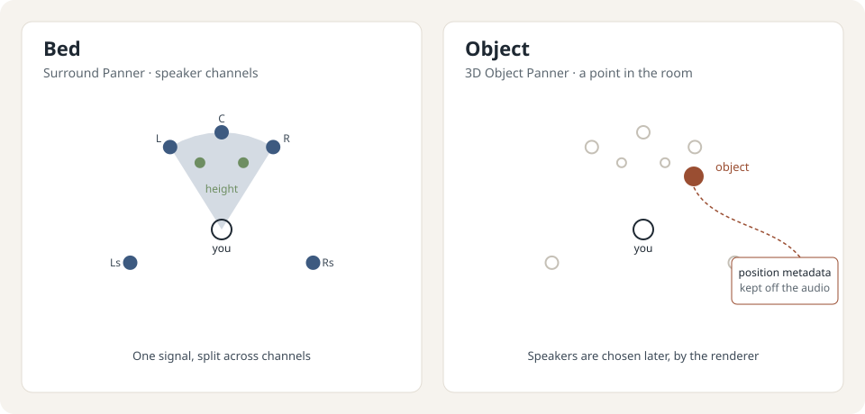
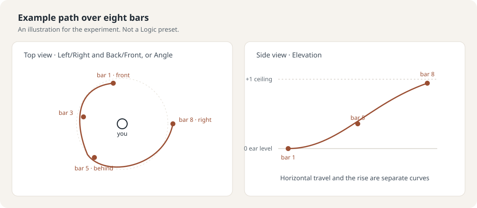

Logic Pro has two native ways to place a sound around you, and they do different jobs.

The Surround Panner spreads a signal across the speakers of a surround format. In a Dolby Atmos project, that is the panner on a bed track. The 3D Object Panner does not aim at speakers. It places one mono or stereo source at a point in the room, and Logic sends that position to the Dolby Atmos plug-in as metadata, kept separate from the audio.

You can automate every parameter of both panners, and of the Surround Balancer, from the track. You can also save a panner position as a preset. A preset is one frozen spot. The movement is the automation.

!!! note
    Checked on 26 November 2026 against Apple's Logic Pro User Guide for Mac. Apple's release notes, published 6 November 2026, list Logic Pro for Mac 13.0 as the current version and do not describe these panners. The steps below have not been run in this studio.

## Surround Panner and 3D Object Panner

A bed track behaves like a conventional surround channel. Its audio goes to one multichannel bus, the surround bed, and the Surround Panner distributes that audio across the bus: left, center, right, surrounds, LFE, and, when the format has them, height. An Atmos project has a single bed, so every bed track lands on that same bus. New tracks in an Atmos project start out as bed tracks. A bed can be mono, stereo, or surround.

An object track takes a different route. The audio is mono or stereo, never surround, and it goes straight to one object input on the Dolby Atmos plug-in. The 3D Object Panner does not pan between speakers. It writes a position, and that position travels as its own metadata to the same object input. The plug-in can hold up to 118 objects. A stereo track uses two of them.

On the channel strip the difference is visible. A bed shows the round Surround Panner. An object shows a square pan control, which is the only mark Apple calls out, plus an Elevation slider. The Output slot reads Surround or Object accordingly.

*A bed splits one signal across speaker channels. An object stores a point, and the renderer places it. Original diagram.*

| | Bed, Surround Panner | Object, 3D Object Panner |
| --- | --- | --- |
| What you set | Levels across speaker channels | A point in the room |
| Tracks | Mono, stereo, or surround | Mono or stereo only |
| How many | One surround bed in an Atmos project | Up to 118 objects; stereo uses two |
| Height | Only the height speakers the bed format has | Elevation from ear level, 0, toward the ceiling, +1 |
| LFE | A level slider | No LFE control |
| Master effects | Runs through plug-ins placed before the Dolby Atmos plug-in | Skips those plug-ins |

### Which one to reach for

Use a bed for the foundation of the mix: a kit, a room, a pad that should sit in the speaker layout, anything that needs the LFE, and anything you want processed by plug-ins on the surround master before the Dolby Atmos plug-in.

Use an object when one mono or stereo part should travel as its own point. That includes paths the bed cannot draw. A 7.1.2 bed, the Atmos default, has one overhead pair, top middle left and top middle right. You cannot place a bed signal at the front or the back of the ceiling. An object is not tied to those speakers.

A surround-format channel, as opposed to mono or stereo, shows a Surround Balancer rather than a Surround Panner. It does not relocate the sound. It raises or lowers the existing speaker channels as a group. Its parameters can be automated too.

Several tracks cannot share one object, so they cannot share one object's pan either. Apple's documented way to move a group together is to route the tracks to a bus, create an aux fed by that bus, and set the aux Output slot to 3D Object Panner. The group then moves as one object. That is a shared position, not independent positions with one shared effect.

## Use the native controls

### Turn on surround output

Surround and Atmos are different project setups.

For surround without Atmos, choose File > Project Settings > Audio, click General, and pick a format from the Surround Format menu. A new surround project defaults to 5.1. Formats with height channels, 5.1.2, 5.1.4, 7.1.2, and 7.1.4, add an Elevation slider. Then click the channel strip's Output slot and choose Output > Surround. The Pan knob becomes the Surround Panner: speaker dots, and a green dot for the position.

You can select a surround format even when the interface has only two outputs. Hearing the real speaker layout still needs one output and one speaker per channel. Apple's guide treats stereo-speaker monitoring as a poor way to judge a surround mix. Headphone playback is below.

For Atmos, the bed format can only be 5.1, 7.1, or 7.1.2. A new Atmos project uses 7.1.2.

### Open the Surround Panner

Drag the green dot. Option-click it to return to front center. Double-click the Surround Panner on the channel strip to open the window, which is where the extra controls are.

Angle is the direction around you. Diversity is how many speakers share the sound: 0 sits on the nearest speaker, and 1, which Apple also calls super mono, plays through all of them. Hold Command while dragging to keep diversity still. Hold Control and Command to keep the angle still. Option-click the puck in the window to reset angle and diversity.

Elevation is degrees from the ear-level speakers, 0°, up to the height speakers, 90°. It exists only when the format has height channels. With height, the window can show a Planar field or a Spherical one. Planar is the flat circle. Spherical draws a dome from above, and moving the puck to the center there drives elevation to 90°, so the sound leaves the ear-level speakers and plays from the height speakers. If you want a level circle and a separate rise, stay in Planar and move Elevation on its own.

A 7.1.2 bed still only has that one overhead pair. Elevation on a bed moves energy toward those two speakers. It does not give you a front ceiling and a rear ceiling.

### Turn on Dolby Atmos

From the project chooser: File > New from Template, New Project, then Empty Project or Live Loops. Open Details, and set the Spatial Audio menu to Dolby Atmos. Logic sets the frame rate to 24 fps and the surround format to 7.1.2. You can change either. Apple recommends a sample rate of 48 kHz or 96 kHz. Click Choose, then create the tracks.

Those tracks come up as beds. Their outputs are Surround, the panner is the Surround Panner with an Elevation slider, the ordinary output channel strip is hidden, and the master becomes the surround master with the Dolby Atmos plug-in inserted. You do not insert that plug-in yourself.

On a project that already exists: File > Project Settings > Audio, General, and set Spatial Audio to Dolby Atmos. The bed format switches to 7.1.2, and the frame rate in the Synchronization settings switches to 24 fps. You can set the bed back to 5.1 or 7.1. Do not change the sample rate after you have recorded audio. If the project is already a finished stereo or surround mix, Apple recommends saving a copy or a project alternative first, so the conversion does not overwrite that mix. Plug-ins already on the tracks can change channel mode when a surround project is converted, which can change the sound.

### Change a bed track into an object track

Only a mono or stereo track can become an object. A surround track cannot.

In the Atmos project, do one of the following:

- Click the Output slot and choose 3D Object Panner.
- Control-click the Surround Panner and choose 3D Object Panner.

The Output slot label changes from Surround to Object, and the round panner becomes the square one. Several selected channel strips can be switched together from one Output slot.

To go back, Control-click the 3D Object Panner and choose Pan, or click the Output slot and choose Pan or Output > Surround. The label returns to Surround, and the track is a bed again.

### Set horizontal position and elevation

On the channel strip, drag the puck across the square for the horizontal position. Option-click the plane to reset it to center front. Drag the Elevation slider for height.

Double-click the pan control on the channel strip or on the track header to open the 3D Object Panner window. The upper grid moves the object left, right, front, and back. The lower grid moves it left, right, up, and down. A mono object is one puck. A stereo object has a left puck, a right puck, and a center puck that moves both, plus a Spread value for the stereo width.

The numbers, dragged or typed:

- Left/Right is 0 at the center, −1 at far left, and +1 at far right.
- Back/Front is +1 at the front, 0 at the listening position, and −1 at the back.
- Elevation is 0 at ear level and +1 at the ceiling.
- Size makes the image more diffuse as it rises. The window draws that as a halo around the puck.
- Spread is stereo only.

Apple's parameter page describes elevation as ear level at 0 and the ceiling at +1, and the lower grid as up and down. It does not describe a value below the floor in that list.

The position is an XYZ coordinate, not a speaker address. Creating it writes metadata that is sent to the matching object input, separate from the audio. There is no LFE send on this panner.

### Listen on ordinary headphones, without head tracking

For an Atmos project, open the Dolby Atmos plug-in on the surround master and set Monitoring Format to Dolby Renderer. Apple describes that as the standard binaural format, the one that is always available, and it is for headphones. Leave Head Tracking off. The Head Tracking button is only offered when head-tracking headphones or earbuds, such as AirPods Pro or AirPods Max, are the selected output. Ordinary headphones do not need it, and the button is not there for them.

Apple Renderer is the other headphone choice. It is the virtualization Apple Music and Apple TV use. It has its own Head Tracking button, with the same requirement: capable headphones selected as the output. Apple's note on that format also says Apple Renderer with head tracking needs a Mac with Apple silicon. For a check on ordinary headphones, Dolby Renderer is the format that does not depend on that.

Two stereo monitoring formats, 2.0 Direct and 2.0 from 5.1 Downmix, are folded stereo approximations. They are not the binaural render. Use them when you want to hear a stereo reduction, not when you want to hear the spatial mix.

Which formats appear depends on the hardware connected at the time. Dolby Renderer is the one Apple marks as always available.

A surround project that is not Atmos uses a different plug-in. On the surround master, click the last Audio Effect slot and choose Imaging > Spatial Audio Monitoring. Set Monitoring Format to Apple Renderer and leave Head Tracking off. The plug-in needs macOS Monterey 12.3 or later. Head tracking in that plug-in is off while you bounce, and it is only available with capable headphones selected as the output. This plug-in is for a surround mix. An Atmos mix is monitored from the Dolby Atmos plug-in.

## Automate the movement

Apple documents automation for every parameter of the Surround Panner, the Surround Balancer, and the 3D Object Panner. The curves are ordinary track automation.

### Record it while the project plays

Choose Mix > Show Automation, or press A, or click Show/Hide Automation in the Tracks area menu bar. Each track header then shows an Automation button, an Automation Parameter menu, and an Automation Mode menu. You can also pick the mode on the channel strip.

Set the mode to Latch or Touch. Apple describes Write as the mode that erases existing automation as the playhead passes, and says Touch and Latch are the ones you actually use. Touch plays the existing curve and lets you override it while you hold the control, then returns to the curve when you let go. Latch keeps the new value after you release.

Start playback or recording, then drag the puck or the Elevation slider. Nothing is written while the project is stopped. The lane shows the parameter you are moving, and the curve is recorded onto the track.

### Find the parameters in the menu

The panner parameters are in the Main submenu of the Automation Parameter menu on the track header. Volume, Pan, Solo, and Mute live in that same Main submenu. You can also Control-click the automation lane and choose the parameter from the Automation Parameter submenu there.

For a bed, the useful pair is Angle and Elevation, with Diversity if you want the sound to widen or tighten as it moves. For an object, draw Left/Right and Back/Front for the ground plan, and Elevation for the height. Size and Spread are in the same family of panner parameters if you want the image to bloom or the stereo pair to open.

To see more than one curve, click the disclosure arrow at the lower left of the track header, then click the + that appears when you hover the header. Each extra lane can show a parameter that already has data, and you can choose what the lane displays from its own Automation Parameter menu.

### Draw and edit the curves

Choose the parameter first. Then use the Pencil tool to draw the curve, or add points and drag them. Drag a point up or down to change the value, and left or right to move it in time. Use the ruler to line the point up with a bar.

A circle around the listener is only the horizontal parameters: Angle on a bed, or Left/Right together with Back/Front on an object. The rise is a second curve, Elevation. One will not invent the other, apart from the Surround Panner's Spherical behavior, where pushing the puck to the center also raises elevation. If the path should stay at ear level and then climb, automate those axes separately.

### Save a position, which is not the same thing as saving a move

The Surround Panner window and the 3D Object Panner window have a Settings menu in the header, the same kind of menu a plug-in window has. From that menu you can save the current position as a preset and recall it on another track or in another project. Apple says the files are stored with your other plug-in settings, in `~/Music/Audio Music Apps/Plug-In Settings/`, inside the folder Surround Panner and 3D Object Panner.

Save As Default makes the current position the one a new channel strip opens with, and the one you get when you switch a track to the 3D Object Panner.

That preset is one position. Loading it does not draw a path, and it does not store the automation. The path stays on the track as automation curves, which you can edit, copy, and move like any other track automation. If you want the flight in another song, copy the automation. If you want the ending spot, save the preset.

## A short experiment

Use a sustained synth pad, or a guitar phrase that repeats, over eight bars. The path below is an example you draw. It is not a factory preset, and it has not been auditioned in this studio.

*An example eight-bar path: around the listener, then upward. Horizontal movement and elevation are separate automation curves. Original diagram.*

1. Create an Atmos project as above, with one software instrument or audio track, and the phrase on that track. It starts as a bed. Leave the bed format at 7.1.2 so Elevation exists.
2. Show automation and set the mode to Latch. Play, and drag the Surround Panner slowly from the front, out to the left, and behind you over the first four bars. Over the last four, bring it to the right and raise Elevation from the ear-level speakers toward the overhead pair. Or draw it: choose Angle from the Main submenu and draw the trip, then add an Elevation lane for the rise. Keep Diversity off 0 if you do not want the phrase to collapse onto a single speaker.
3. Make a second track with the same phrase. On that track, click the Output slot and choose 3D Object Panner. Mute the bed while you draw. Record or draw Left/Right and Back/Front so the object takes the same trip around you, and draw Elevation from 0 toward +1 across the eight bars. The bed's automation does not become the object's automation. Draw the object curves on the object track.
4. Put on ordinary headphones. In the Dolby Atmos plug-in, set Monitoring Format to Dolby Renderer and leave Head Tracking off. Solo the bed, then solo the object.

The bed version is the phrase folded into the 7.1.2 speaker channels and then rendered for headphones. The overhead move can only reach the single top-middle pair. The object version is one point moving in the room, rendered from its metadata, unless you raise Size and let it bloom. They should not match. That difference is the comparison.

If you want the object's last position in another project, open the 3D Object Panner window and save it from the Settings menu. The eight-bar flight stays in the automation lanes.

## Limits

- These steps are from Apple's guide. They have not been confirmed on this machine.
- An Atmos bed is 5.1, 7.1, or 7.1.2. The 7.1.2 bed cannot put a signal on the front or rear ceiling.
- Objects are mono or stereo only. A stereo object spends two of the 118 object slots.
- Object audio does not pass through plug-ins inserted on the surround master before the Dolby Atmos plug-in. Bed audio does.
- Tracks cannot share one object. The documented group move is an aux with its output set to the 3D Object Panner.
- The 3D Object Panner has no LFE control.
- A panner preset recalls a position. It does not recall a trajectory.
- Monitoring formats depend on the connected hardware. Dolby Renderer is the headphone format Apple describes as always available. Head tracking stays off unless the output is a capable headset, and it is a separate button.

## Further questions

Not researched, and not answered here:

- LFO-driven spatial movement
- Mathematical orbital trajectories
- External MIDI controllers
- iPhone motion-based panning
- Independent spatial positioning with shared effects

## Sources

- [Overview of surround and Spatial Audio in Logic Pro for Mac](https://support.apple.com/guide/logicpro/lgcp57f6cc60/mac)
- [Set the surround format in Logic Pro for Mac](https://support.apple.com/guide/logicpro/lgcp31f98655/mac)
- [Surround panning in Logic Pro for Mac](https://support.apple.com/guide/logicpro/lgcp5d85917e/mac)
- [Overview of the Logic Pro for Mac Surround Panner](https://support.apple.com/guide/logicpro/lgcp70a62f51/mac)
- [Surround Panner parameters in Logic Pro for Mac](https://support.apple.com/guide/logicpro/lgcp7a500829/mac)
- [Create a Spatial Audio with Dolby Atmos project in Logic Pro for Mac](https://support.apple.com/guide/logicpro/lgcp47c1ef2c/mac)
- [Bed tracks and object tracks in Logic Pro for Mac](https://support.apple.com/guide/logicpro/lgcp73f9b9ac/mac)
- [Overview of the Logic Pro for Mac 3D Object Panner](https://support.apple.com/guide/logicpro/lgcp4492e120/mac)
- [3D Object Panner parameters in Logic Pro for Mac](https://support.apple.com/guide/logicpro/lgcpa01bed87/mac)
- [Spatial Audio with Dolby Atmos mixing workflows in Logic Pro for Mac](https://support.apple.com/guide/logicpro/lgcp8a3c3dd3/mac)
- [Spatial Audio with Dolby Atmos monitoring formats in Logic Pro for Mac](https://support.apple.com/guide/logicpro/lgcp179f27c1/mac)
- [Spatial Audio Monitoring in Logic Pro for Mac](https://support.apple.com/guide/logicpro/lgcpde5e907c/mac)
- [Overview of automation in Logic Pro for Mac](https://support.apple.com/guide/logicpro/lgcpb1a1ea03/mac)
- [Show automation curves in Logic Pro for Mac](https://support.apple.com/guide/logicpro/lgcpb1a3f099/mac)
- [Choose automation modes in Logic Pro for Mac](https://support.apple.com/guide/logicpro/lgcpb1a6ab26/mac)
- [Record live automation in Logic Pro for Mac](https://support.apple.com/guide/logicpro/lgcpb1a6c15d/mac)
- [Adjust automation points on the automation track and in regions in Logic Pro for Mac](https://support.apple.com/guide/logicpro/lgcp5d5e5427/mac)
- [Logic Pro for Mac release notes](https://support.apple.com/en-us/109503)
